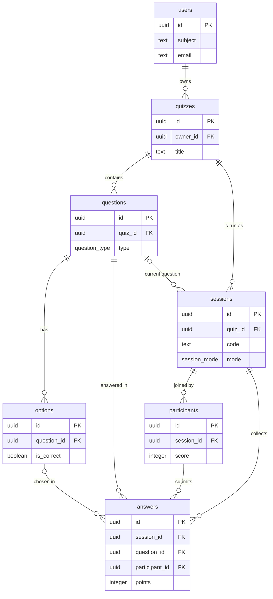

# Data dictionary and schema design

The authoritative description of quizza's persistent storage. It matches the
Drizzle schema in `src/lib/db/schema.ts` and the generated SQL in
`drizzle/`. The HTTP request and response shapes (DTOs) are a separate concern,
documented by OpenAPI at `/api/v1/openapi.json` and rendered at `/docs`.

- Database: PostgreSQL 16.
- Access: Drizzle ORM over the `postgres` (postgres.js) driver.
- Identifiers: UUID v4 primary keys (`gen_random_uuid()`).
- Timestamps: `timestamp with time zone`, defaulting to `now()`.
- Money/score/points: plain integers.

## Entity relationship overview

## Enumerated types

| Type | Values | Used by |
|------|--------|---------|
| `question_type` | `multiple_choice`, `true_false`, `poll`, `word_cloud`, `scale`, `open_text` | `questions.type` |
| `session_mode` | `live`, `scheduled` | `sessions.mode` |
| `session_status` | `lobby`, `active`, `ended` | `sessions.status` |

## Tables

### users

Host accounts. A row exists once a host signs in (OIDC) or registers (email and
password). Anonymous participants are not users.

| Column | Type | Null | Default | Notes |
|--------|------|------|---------|-------|
| id | uuid | no | `gen_random_uuid()` | PK |
| subject | text | yes | | OIDC subject (`sub`). Unique when present. |
| email | text | yes | | Host email. |
| name | text | yes | | Display name. |
| avatar_url | text | yes | | From OIDC `picture`. |
| created_at | timestamptz | no | `now()` | |

Indexes: unique `users_subject_key (subject)`.

Planned (not yet present): `password_hash`, `role`, `member`, `github_id`. See
ADR 0014.

### quizzes

A reusable quiz template.

| Column | Type | Null | Default | Notes |
|--------|------|------|---------|-------|
| id | uuid | no | `gen_random_uuid()` | PK |
| owner_id | uuid | yes | | FK `users.id` ON DELETE SET NULL. Null allows anonymous drafts. |
| title | text | no | | |
| description | text | yes | | |
| cover_icon | text | no | `'shapes'` | Lucide icon key (no emoji). |
| theme | text | no | `'grape'` | Palette key. |
| settings | jsonb | no | `'{}'` | See QuizSettings below. |
| created_at | timestamptz | no | `now()` | |
| updated_at | timestamptz | no | `now()` | Set by the app on update. |

Indexes: `quizzes_owner_idx (owner_id)`.

### questions

An ordered slide within a quiz.

| Column | Type | Null | Default | Notes |
|--------|------|------|---------|-------|
| id | uuid | no | `gen_random_uuid()` | PK |
| quiz_id | uuid | no | | FK `quizzes.id` ON DELETE CASCADE |
| position | integer | no | `0` | Order within the quiz, contiguous from 0. |
| type | question_type | no | `'multiple_choice'` | |
| prompt | text | no | | May be empty while editing. |
| media_url | text | yes | | Image or media for the question (roadmap). |
| time_limit_sec | integer | no | `20` | |
| points | integer | no | `1000` | Base points for a correct answer. |
| settings | jsonb | no | `'{}'` | See QuestionSettings below. |
| created_at | timestamptz | no | `now()` | |

Indexes: `questions_quiz_idx (quiz_id, position)`.

### options

An answer choice for an option-based question (`multiple_choice`, `true_false`,
`poll`).

| Column | Type | Null | Default | Notes |
|--------|------|------|---------|-------|
| id | uuid | no | `gen_random_uuid()` | PK |
| question_id | uuid | no | | FK `questions.id` ON DELETE CASCADE |
| position | integer | no | `0` | Order within the question. |
| label | text | no | | Option text. |
| is_correct | boolean | no | `false` | For scorable types. |
| color | text | yes | | Palette key for the tile. |

Indexes: `options_question_idx (question_id, position)`.

### sessions

A single run of a quiz, either live or scheduled.

| Column | Type | Null | Default | Notes |
|--------|------|------|---------|-------|
| id | uuid | no | `gen_random_uuid()` | PK |
| quiz_id | uuid | no | | FK `quizzes.id` ON DELETE CASCADE |
| code | text | no | | Six-digit join code. Unique among non-ended sessions (partial index). |
| mode | session_mode | no | `'live'` | |
| status | session_status | no | `'lobby'` | Live lifecycle. Scheduled runs are created `active`; openness is gated by the window. |
| host_token | text | no | | Secret that authorizes host control. Returned only at creation. |
| current_question_id | uuid | yes | | FK `questions.id` ON DELETE SET NULL. Live cursor. |
| question_started_at | timestamptz | yes | | When the live question went live (server-side timing). |
| opens_at | timestamptz | yes | | Scheduled window start. |
| closes_at | timestamptz | yes | | Scheduled window end. |
| created_at | timestamptz | no | `now()` | |
| ended_at | timestamptz | yes | | Set when the run ends. |

Indexes: `sessions_quiz_idx (quiz_id)`; partial unique
`sessions_code_active_key (code) WHERE status <> 'ended'` so a code is unique
while live and reusable after a run ends.

### participants

A person in a session. Anonymous by default.

| Column | Type | Null | Default | Notes |
|--------|------|------|---------|-------|
| id | uuid | no | `gen_random_uuid()` | PK |
| session_id | uuid | no | | FK `sessions.id` ON DELETE CASCADE |
| nickname | text | no | | Chosen display name. |
| team_name | text | yes | | Chosen team, nullable for individual quizzes. |
| avatar_color | text | no | `'grape'` | Palette key; monogram avatar. |
| score | integer | no | `0` | Running total, updated on scored answers. |
| client_token | text | no | | Secret for reconnect and answer submission. |
| joined_at | timestamptz | no | `now()` | |

Indexes: `participants_session_idx (session_id)`; unique
`participants_session_client_key (session_id, client_token)`.

### answers

One response by one participant to one question. The shared pipeline for both
run modes; records accuracy and timing identically.

| Column | Type | Null | Default | Notes |
|--------|------|------|---------|-------|
| id | uuid | no | `gen_random_uuid()` | PK |
| session_id | uuid | no | | FK `sessions.id` ON DELETE CASCADE |
| question_id | uuid | no | | FK `questions.id` ON DELETE CASCADE |
| participant_id | uuid | no | | FK `participants.id` ON DELETE CASCADE |
| option_id | uuid | yes | | FK `options.id` ON DELETE SET NULL. Option-based answers. |
| text_value | text | yes | | word_cloud and open_text answers. |
| number_value | integer | yes | | scale answers. |
| is_correct | boolean | no | `false` | Server-computed. |
| response_ms | integer | yes | | Time taken. Server-measured (live) or client-reported and clamped (scheduled). |
| points | integer | no | `0` | Server-computed, never trusted from the client. |
| created_at | timestamptz | no | `now()` | |

Indexes: `answers_question_idx (question_id)`, `answers_session_idx (session_id)`;
unique `answers_unique_response (question_id, participant_id)` enforcing one
answer per participant per question.

## JSONB sub-schemas

These are validated in the application (zod and TypeScript in
`src/lib/db/schema-types.ts`), not by the database.

### QuizSettings (`quizzes.settings`)

| Key | Type | Meaning |
|-----|------|---------|
| shuffleQuestions | boolean | Randomize question order. |
| shuffleOptions | boolean | Randomize option order. |
| showLeaderboard | boolean | Show a leaderboard between questions. |
| allowLateJoin | boolean | Permit joining after start (live). |
| teamSelection | boolean | Require a team choice when joining. |
| teamNames | string[] | Available teams, deduplicated without case sensitivity. |
| teamSize | integer | Maximum participants per team, 1–4. |

### QuestionSettings (`questions.settings`)

| Key | Type | Meaning |
|-----|------|---------|
| scaleMin | integer | Scale lower bound. |
| scaleMax | integer | Scale upper bound. |
| scaleMinLabel | string | Label for the low end. |
| scaleMaxLabel | string | Label for the high end. |
| maxWords | integer | Word-cloud entries per player. |
| speedBonus | boolean | Faster correct answers earn more points. |

## Referential actions summary

- Deleting a quiz cascades to its questions, options, sessions, participants,
  and answers.
- Deleting a user sets `quizzes.owner_id` to null (the quiz survives).
- Deleting an option sets `answers.option_id` to null (the answer survives with
  its recorded correctness and points).

## Planned schema extensions

Tracked here so the current state is not confused with the roadmap. See the SDD
and ADRs for context.

- Host auth: `users.password_hash`, `users.role`, `users.member`.
- Custom participant fields: a `participant_fields` definition on the quiz plus a
  `participant_responses` store, so hosts can collect required data (PRD).
- A standalone powerup catalog and per-participant use ledger; today the four
  configurable powers and their uses are stored in quiz settings and answers.
- Media: `questions.media_url` exists; an uploads table or object-store
  references will accompany it.
- Scheduled attempt tracking: a per-participant attempt start time to measure
  self-paced response time server-side rather than trusting the client.
