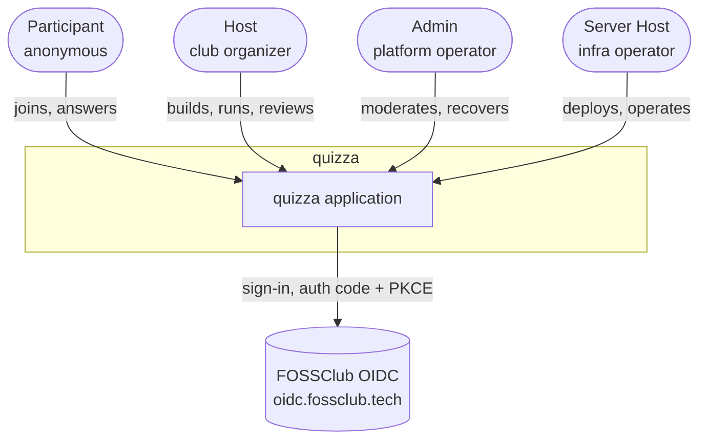
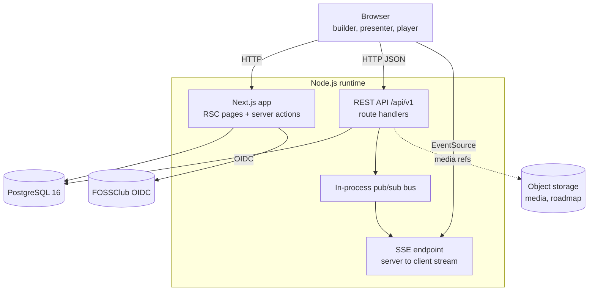
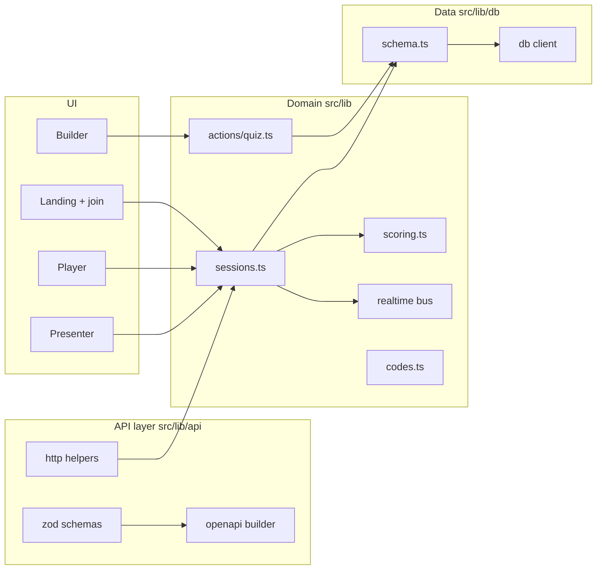
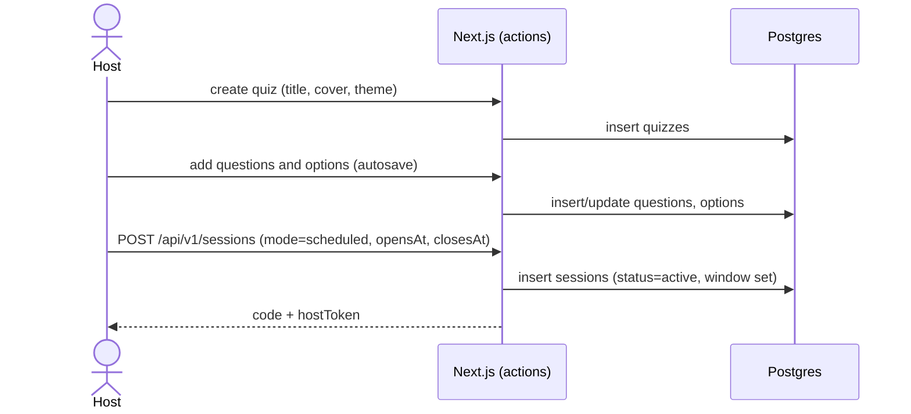
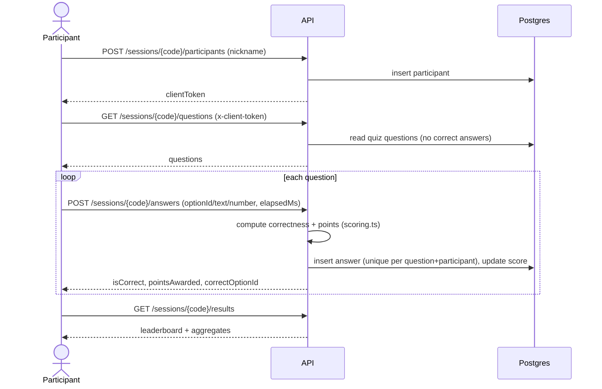
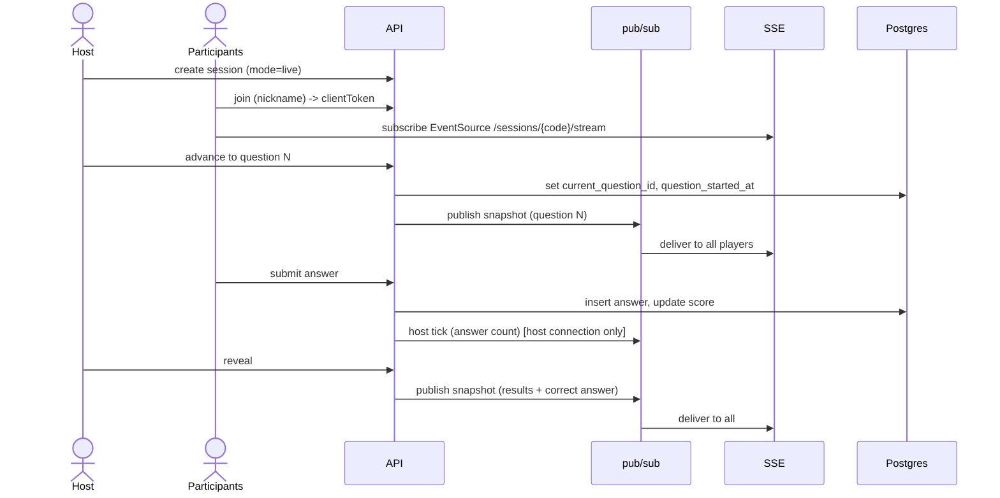
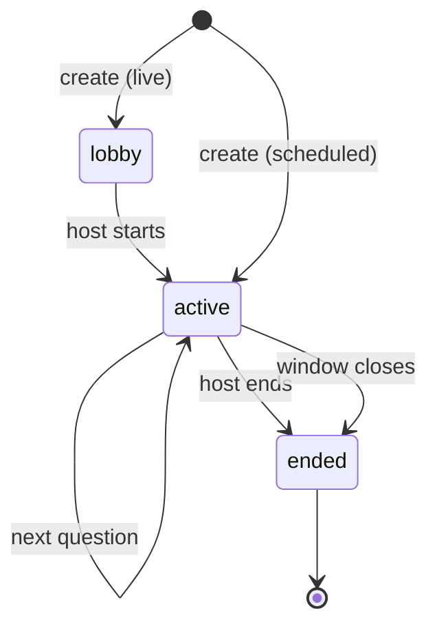
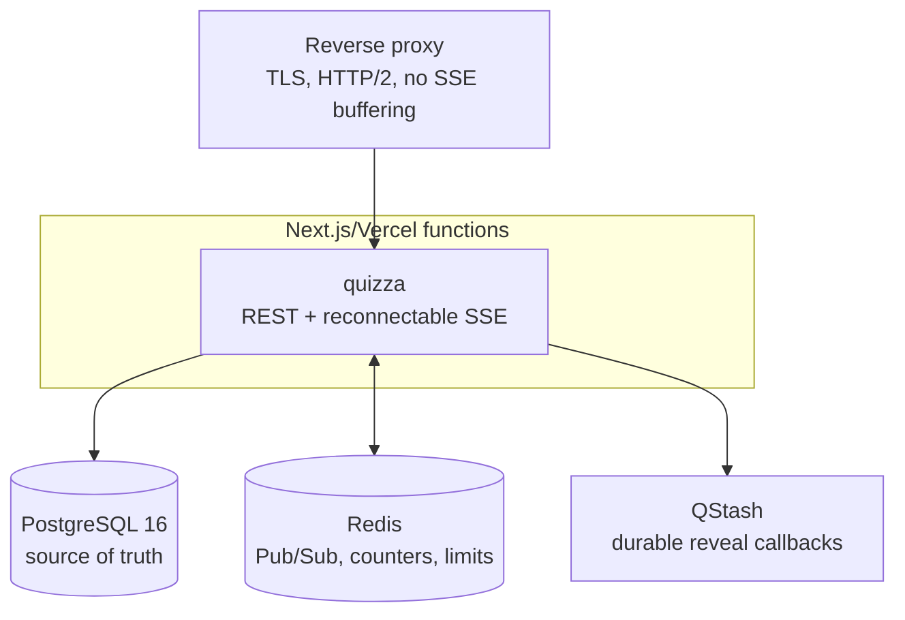
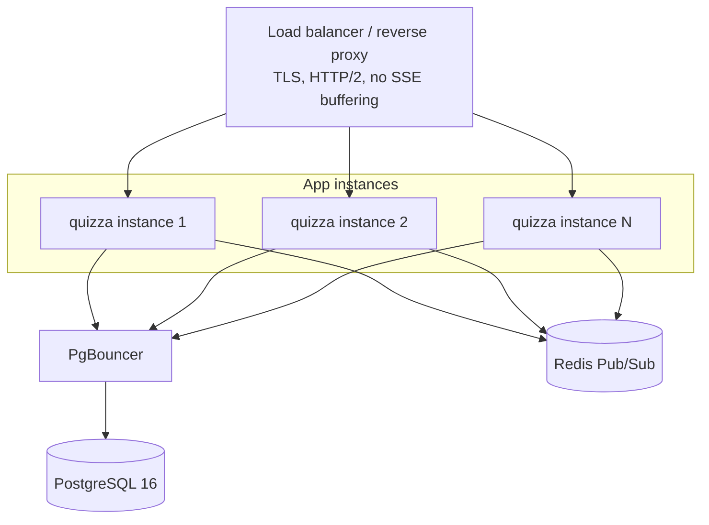

# System Design Document (SDD)

Status: living document. Owner: engineering. Audience: contributors and
reviewers. For the reasoning behind specific choices see
[decisions.md](./decisions.md); for storage detail see
[data-dictionary.md](./data-dictionary.md); for security analysis see
[threat-model.md](./threat-model.md).

## 1. Purpose and scope

quizza is a free and open-source platform for running live and scheduled
quizzes, a FOSS alternative to Mentimeter and similar tools. The first operator
is UFC at GGSIPU East campus, extending to other clubs and colleges and then to
anyone who wants to host a quiz or test. This document specifies the system
architecture, the major components and their boundaries, the main runtime
workflows, the data flows, and the non-functional requirements.

Source requirements: [PRD.md](../PRD.md).

## 2. Goals and non-goals

Goals:

- Anonymous participation: join with a nickname and an avatar, no account.
- Host accounts via FOSSClub OIDC or email and password.
- Build quizzes with multiple question types, per-question time and points.
- Run a quiz live (host-driven, synchronized) or scheduled (open for a window,
  self-paced), recording accuracy and response time either way.
- Results and leaderboards ranked by accuracy and speed.
- A clean, smooth UI.

Non-goals for the near term (tracked as roadmap, not dropped): a broader
powerup catalog, rich media pipelines beyond current uploads, quests, and
horizontal multi-region scale.

## 3. Context (C4 level 1)

Actors:

- Participant: joins a quiz and answers questions. No account required.
- Host: creates quizzes, runs or schedules them, reviews results. Signs in.
- Admin: platform operator with elevated control and a recovery path.
- Server Host: operates the infrastructure (deploy, backups, scaling).

## 4. Containers (C4 level 2)

Containers:

- Next.js application (single deployable): server-rendered pages, the builder,
  the presenter and player UIs, server actions for internal builder CRUD, the
  versioned REST API under `/api/v1`, and the reconnectable SSE endpoint. Runs
  on the Node.js runtime so Redis subscriptions and streaming work.
- PostgreSQL: the system of record.
- Redis: cross-instance Pub/Sub, short-lived answer counters, and rate limits.
- QStash: signed delayed callbacks for automatic live reveals.
- FOSSClub OIDC: external identity provider for hosts.
- Object storage (roadmap): media for questions.

Scale-out note: live mode runs across multiple serverless instances through the
Redis backplane. Pub/Sub is ephemeral, so reconnecting SSE streams rebuild from
Postgres. See section 9 and ADR 0021.

## 5. Components (C4 level 3)

Component responsibilities:

- API layer (`src/lib/api`): zod request and response schemas, HTTP helpers
  (validation, typed errors, the handler wrapper), and the OpenAPI 3.1 builder
  that generates the spec from those same schemas.
- Domain (`src/lib`): `sessions.ts` holds session lifecycle, join, questions,
  answer submission, and results; `scoring.ts` is pure scoring; `actions/quiz.ts`
  is builder CRUD via server actions; `realtime` is the pub/sub bus; `codes.ts`
  generates join codes and tokens.
- Data (`src/lib/db`): Drizzle schema, client, migrations, and client-safe type
  mirrors.

## 6. Technology stack

| Layer | Choice | Reason (ADR) |
|-------|--------|--------------|
| Framework | Next.js 16, App Router, React 19 | 0001 |
| Language | TypeScript | 0001 |
| Styling | Tailwind CSS v4 | 0004 |
| Animation | motion (Framer Motion) | 0004 |
| ORM | Drizzle | 0002 |
| Database | PostgreSQL 16 | 0002 |
| Validation | zod | 0011 |
| API docs | OpenAPI 3.1 + Scalar | 0011 |
| Realtime | SSE + request/response | 0009 |
| Auth | FOSSClub OIDC + email/password | 0012, 0014 |

## 7. Key workflows

### 7.1 Create and schedule a quiz

### 7.2 Scheduled (self-paced) play

### 7.3 Live (host-driven) play

## 8. State and data flows

### 8.1 Session lifecycle

Live sessions move `lobby -> active -> ended` under host control, with
`current_question_id` and `question_started_at` tracking the live cursor.
Scheduled sessions are created `active`; effective openness is computed from
`opens_at` and `closes_at`, and the run is considered ended after the window.

### 8.2 Answer and scoring flow

An answer is validated against the question type, correctness is computed
server-side from the stored options, response time is taken from the server
clock (live) or a clamped client report (scheduled), and points come from
`scoring.ts`. The client never supplies correctness or points. One answer per
participant per question is enforced by a unique index.

## 9. Non-functional requirements

### 9.1 Operating target

The realistic target the system must run stably against (ADR 0018):

- Audience: 1000 to 2000 participants in an event.
- Workload per participant: about 30 submissions, while actively taking the quiz
  for 30 to 45 minutes.
- Event window: up to 4 hours, within which participants start and finish at
  their own pace (primarily scheduled mode).
- Must run stably for the full window with smooth UI and no degradation.

The earlier PRD figure (10 parallel quizzes of 1000) is treated as an aspiration,
not the near-term target; see ADR 0015 for the contingency plan if it is ever
needed.

### 9.2 Load analysis

- Total writes: 2000 x 30 = 60,000 submissions across the event.
- Spread across the 4-hour window: about 4 submissions per second average.
- Worst realistic clustering (all active within the same 45-minute block): about
  22 per second average, roughly 50 to 70 per second at peak.
- Scheduled mode is request/response, so there are no long-lived connections;
  2000 participants are ordinary web traffic, not 2000 held-open streams.
- A live room of this size is the only case with held-open SSE connections (1000
  to 2000) and a synchronized submit burst (a few hundred per second for a few
  seconds when a question closes).

### 9.3 Design response

- Vercel functions are horizontally distributed; one Redis subscriber per warm
  instance fans out to all local SSE streams. Postgres is pooled and bounded per
  function (`DB_POOL_MAX=5` by default on Vercel).
- Stability over four hours remains a requirement: SSE streams must be
  unsubscribed, rotated before the platform duration limit, and cleaned up on
  disconnect, with no unbounded memory growth.
- Fan-out discipline (already decided): phase changes broadcast one snapshot to
  all; live answer counts go only to the presenter connection; never rebroadcast
  per answer to all players.
- Capacity is not yet a verified claim. Run the multi-instance load harness
  before promising the PRD target, and move only the SSE tier to a long-running
  service if Vercel stream duration or cost becomes the limiting factor.

## 10. Feature scope and phasing

MVP (in progress):

- Builder with six question types, per-question time and points (done).
- REST API with OpenAPI (done).
- Scheduled mode UI and live mode UI (done; capacity validation remains).
- Host sign-in (OIDC and email/password) and quiz ownership.
- Results with ranking by accuracy and speed; per-question leaderboard.

Post-MVP (roadmap, data model has extension points):

- A larger powerup catalog (for example hints) and richer per-player analytics.
- In-question multimedia with object storage.
- Custom participant data fields collected by the host at join.
- Quests and other engagement mechanics.
- Cheat prevention hardening (see threat model).

## 11. Deployment view

### 11.1 Target deployment (scaled out)

This is the production live-mode target. Capacity remains unclaimed until the
Preview load thresholds in the realtime plan have been measured.

- The app can run as Vercel functions or as a multi-stage Docker image producing
  Next's standalone server (ADR 0019). `docker compose up --build` starts
  Postgres and Redis, runs migrations once, then starts one local app instance.
- Redis Pub/Sub is the production backplane. A per-instance local registry
  shares one Redis subscription across that instance's SSE requests. Pub/Sub is
  ephemeral, so every stream reconnects to a fresh Postgres snapshot.
- The reverse proxy must disable response buffering for the SSE route (for
  example `X-Accel-Buffering: no`) and use HTTP/2 so streams multiplex per
  client.
- Use a pooled Postgres URL and keep each serverless instance's pool bounded
  (`DB_POOL_MAX`, default 5 on Vercel). Redis answer counters avoid a database
  count and full-room broadcast after every answer.
- Migrations run as a one-shot `migrate` service (compose) before the app
  starts, or manually with `pnpm db:generate` then `pnpm db:migrate`. See ADR
  0003.
- Scaling later is a replica-count change: run N app containers behind a load
  balancer while retaining the Redis backplane, or move only the SSE tier to a
  dedicated long-running service if measured Vercel stream economics require it.

### 11.2 Contingency deployment (dedicated realtime tier)

Use this deployment for live mode. A future dedicated realtime tier remains an
option if measured Vercel SSE concurrency or cost is unacceptable. See ADR
0021 and the load-test runbook.

## 12. Risks and open questions

- Scheduled-mode response time currently relies on a client-reported elapsed
  time, which is clampable but not fully trustworthy. A server-issued per-
  question view token with a timestamp would make it authoritative (threat
  model, Tampering).
- Join codes are six digits. They authorize only participant actions, never host
  control. Distributed Redis rate limiting mitigates brute force and join
  flooding; participant caps and stream-specific limits remain open.
- Quiz ownership checks depend on host auth, which is not yet implemented; until
  then a quiz link grants edit access (acceptable pre-release only).
- Redis/QStash live-mode throughput and cost remain unproven until the load
  harness in `docs/realtime-scale-plan.md` is run against a production-like
  Preview deployment.

## 13. References and inspirations

Design and feature inspirations to study:

- Kahoot and Mentimeter: live, host-driven play and audience interaction.
- buzzr.in: lightweight, fast quiz hosting.
- quizmaster: quiz and test flows.
- allourideas: pairwise voting and idea prioritization, a useful model for poll
  and ranking formats.

Future scale direction (ADR 0020): the high-throughput realtime and submission
tier may later move to a dedicated Go backend for resource efficiency at very
large scale. Direction note only; not built now.
