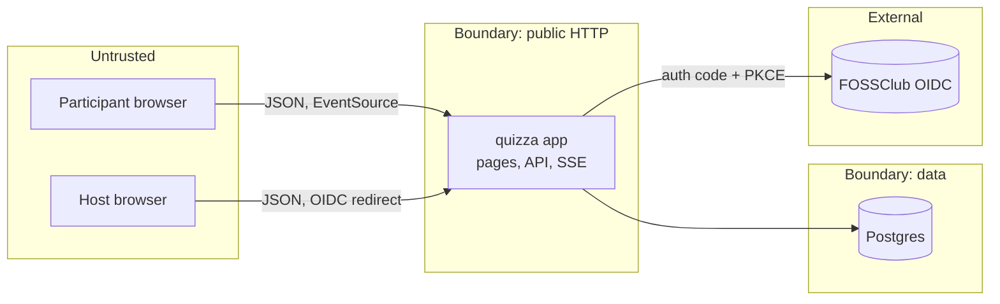

# Threat model

Security analysis of quizza using STRIDE (Spoofing, Tampering, Repudiation,
Information disclosure, Denial of service, Elevation of privilege). It maps
threats onto the architecture in [sdd.md](./sdd.md) and records mitigations and
their status. Status values: Done, Planned, Accepted risk.

## 1. Scope and assets

Assets to protect:

- Quiz integrity: correct answers must not leak before they are revealed.
- Result integrity: scores and rankings must reflect real, server-computed
  answers, not client claims.
- Secrets: `sessions.host_token` (host control) and `participants.client_token`
  (submit and reconnect).
- Host accounts and their PII (email, OIDC identity).
- Participant data: nickname and, in future, host-defined custom fields.
- Availability: a running quiz must stay up for its audience.

## 2. Trust boundaries

The primary boundary is the browser to app edge: every request from a
participant or host is untrusted input. The app to database boundary is trusted
within the deployment. OIDC is an external trusted identity provider reached over
TLS.

## 3. STRIDE analysis

### Spoofing

| Threat | Vector | Mitigation | Status |
|--------|--------|------------|--------|
| Impersonate a host and control a session | Guess or steal `host_token` | 32-char high-entropy token (nanoid), returned only once at creation, never exposed by any read endpoint | Done |
| Impersonate another participant | Guess `client_token` | 32-char high-entropy token; unique per session and participant | Done |
| Fake host identity at sign-in | Forged OIDC assertion | Authorization code flow with PKCE (S256), state and nonce, RS256 ID token verified against JWKS with issuer/audience/nonce checks, client_secret_basic token auth | Code-complete; live pending provider client registration (0012) |
| Join code guessing to enter a room | Six-digit code | Codes grant only participant actions, never host control; add rate limiting and lockout at scale | Partial, rate limiting Planned |

### Tampering

| Threat | Vector | Mitigation | Status |
|--------|--------|------------|--------|
| Inflate own score | Submit points or correctness from the client | Server computes correctness from stored options and points from `scoring.ts`; the client cannot set either | Done |
| Game the speed bonus | Report a tiny `elapsedMs` in scheduled mode | Value is clamped to `[0, timeLimit]`; live mode ignores it and uses the server clock. Server-issued per-question view token with a timestamp is the authoritative fix | Partial, token Planned |
| Submit to a question that is not live | Post to an arbitrary question id | Live mode checks `current_question_id`; scheduled mode checks the open window; question must belong to the quiz | Done |
| Answer a question twice | Repeat submission | Unique index `(question_id, participant_id)` returns 409 | Done |
| Modify quiz content you do not own | Edit another host's quiz | Ownership checks once host auth lands; pre-release a quiz link grants edit access | Planned (0015 dependency) |

### Repudiation

| Threat | Vector | Mitigation | Status |
|--------|--------|------------|--------|
| Deny having submitted an answer | Dispute results | Answers are immutable rows with `created_at`, one per participant per question | Done |
| Deny a host control action | Dispute a session change | Audit log of host actions (who, what, when) keyed by session | Planned |

### Information disclosure

| Threat | Vector | Mitigation | Status |
|--------|--------|------------|--------|
| Learn correct answers before reveal | Read the questions endpoint | `GET /questions` strips `is_correct`; correctness is only returned on a participant's own submit and in results | Done |
| Read the host token | Inspect session info | `GET /sessions/{code}` never returns `host_token`; it is only in the create response | Done |
| See other participants' answers | Enumerate answers | No endpoint exposes per-participant answers to participants; results are aggregates and the leaderboard | Done |
| Leak host PII | Access user records | No endpoint returns user records to participants; host data is only in host-scoped views | Planned (with auth) |
| Enumerate quizzes or sessions by id | Guess UUIDs | UUID v4 identifiers are not enumerable; sensitive reads will be ownership-checked | Partial |

### Denial of service

| Threat | Vector | Mitigation | Status |
|--------|--------|------------|--------|
| Submit storm | Live burst of a few hundred submits when a question closes | Small indexed inserts, a Postgres pool with headroom (15 to 20); single instance absorbs the operating target (ADR 0018). Pooling and coalescing only if scaled out | Partial |
| Join flooding | Mass anonymous participant creation | Rate limiting per IP, optional proof-of-work or captcha, per-session participant caps | Planned |
| SSE connection exhaustion | Open many streams | Horizontal instances, per-IP connection limits, idle timeouts | Planned (0015) |
| Code brute force | Rapid guesses against join codes | Rate limiting and lockout on the join and session-info endpoints | Planned |
| Oversized payloads | Large bodies to API | zod max lengths on all string fields; body size limits at the proxy | Partial |

### Elevation of privilege

| Threat | Vector | Mitigation | Status |
|--------|--------|------------|--------|
| Participant performs host actions | Call host-only endpoints | Host endpoints require the `host_token`; participant tokens cannot control a session | Done for current endpoints, enforced as live-control endpoints land |
| Host acts as admin | Call admin functions | Role-based checks (`users.role`), admin recovery path separated from normal host flows | Planned |
| Cross-session access | Use a token from another session | Tokens are scoped to a session; participant lookups are keyed by `(session_id, client_token)` | Done |

## 4. Cheat prevention

The PRD calls out cheat prevention as desirable. Vectors and responses:

- Reading answers from the network: correct answers are never sent to the client
  before reveal (Information disclosure, Done). This closes the most common
  inspect-the-response cheat.
- Score or correctness forgery: scoring is server-authoritative (Tampering,
  Done).
- Timing manipulation in scheduled mode: `elapsedMs` is clamped now; a
  server-issued, signed per-question view token with a server timestamp would
  make response time authoritative (Planned).
- Multiple identities: an anonymous participant can rejoin under a new nickname.
  For graded assessments, an OIDC-required participation mode ties one attempt to
  one identity (Planned). Per-session participant caps and rate limits reduce
  casual abuse.
- Collusion and out-of-band sharing: partially mitigated by per-question timers,
  option shuffling (`shuffleOptions`), and question shuffling
  (`shuffleQuestions`). Not fully solvable; documented as accepted residual risk
  for anonymous mode.
- Tab or focus switching during a timed question: optional focus and visibility
  checks on the player client can flag or penalize (Planned, best-effort only).

## 5. Transport and platform controls

- TLS everywhere; HTTP/2 at the proxy for SSE multiplexing.
- Secrets in environment variables, never in the client bundle or the repo
  (`.env.local` is gitignored).
- Security headers (CSP, frame options, referrer policy) to be set at the app or
  proxy (Planned).
- Dependency hygiene: lockfile pinned; periodic audit.

## 6. Prioritized follow-ups

1. Host auth (OIDC and email/password) with ownership and role checks. Unlocks
   several Planned items above.
2. Rate limiting on join, session-info, and submit endpoints.
3. Server-issued per-question view token for authoritative scheduled timing.
4. Security headers and body-size limits at the edge.
5. Host-action audit log.
